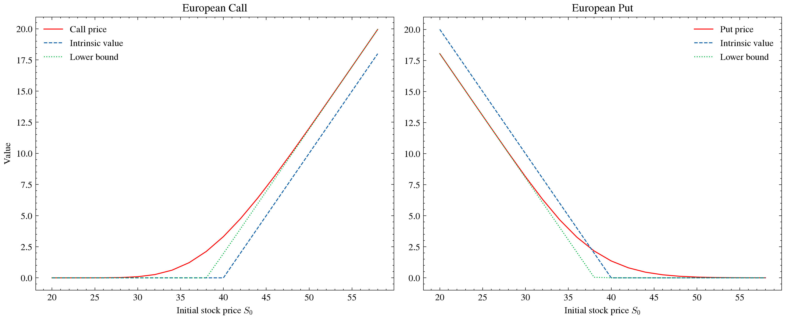
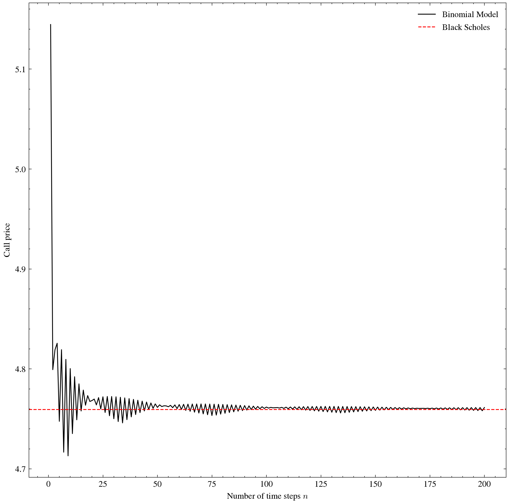

## Overview

이항모형, 위너과정과 이토정리, 블랙숄즈방정식을 이해하고 두가지를 파이썬으로 구현했다.
책의 예제를 사용했고, 책의 답과 일치하는 것을 확인했다.
- Hull 예제( $S_0=42$ , $K=40$ , $r=10\%$ , $\sigma=20\%$ , $T=0.5$ ): $c = 4.76$ , $p = 0.81$ 로 책과 일치

1. 1기간 이항모형, 다기간 이항모형 
2. 블랙-숄즈 옵션가격결정모형

구현 후, 두가지를 그래프로 확인해봤다.

1. 초기 주가에 따른 옵션 가격의 변화
2. 이항 모형에서 기간 수 n에 따른 블랙-숄즈 모형으로의 수렴

## Black–Scholes–Merton
### Differential Equation

- 주가가 기하 브라운 운동을 따른다고 가정하고, 이토 정리로 구한 $df$ (f : 파생상품 가격, S,t의 함수)를 사용한다. 무위험 포트폴리오를 만들면 그 포트폴리오는 r(무위험 이자율)을 얻어야한다. 이를 방정식으로 만들면 다음의 Black–Scholes–Merton 식이 나온다.

$$
\frac{\partial f}{\partial t} + rS\frac{\partial f}{\partial S} + \frac{1}{2}\sigma^2 S^2 \frac{\partial^2 f}{\partial S^2} = rf
$$

- 이 식에는 기대수익률 $\mu$ 가 없다. 즉 투자자의 위험 선호에 따라 달라지는 값이 없으므로, 위험중립 평가를 적용할 수 있다.

### Pricing Formula

$$
c = S_0 N(d_1) - K e^{-rT} N(d_2)
$$

$$
p = K e^{-rT} N(-d_2) - S_0 N(-d_1)
$$

$$
d_1 = \frac{\ln(S_0/K) + \left(r + \frac{\sigma^2}{2}\right)T}{\sigma\sqrt{T}},
\qquad
d_2 = \frac{\ln(S_0/K) + \left(r - \frac{\sigma^2}{2}\right)T}{\sigma\sqrt{T}} = d_1 - \sigma\sqrt{T}
$$

- c, p는 위험중립 평가로 만기 조건(call $\max(S_T-K,0)$ , put $\max(K-S_T,0)$ )의 기댓값을 로그정규분포로 적분하고 $e^{-rT}$ 로 할인하여 도출할 수 있다.

- $N(d_2)$ : 위험중립 세계에서 만기에 콜이 행사될 확률이다. (풋은 $N(-d_2)$ )
- $N(d_1)$ : 콜의 델타와 일치한다. 기초자산이 1 오를 때 콜 가격이 오르는 양이다. (풋은 $-N(-d_1)$ )

## Figures

### Option Value vs Initial Stock Price

무배당의 경우, 
- call은 항상 Intrinsic value가 Lower bound 아래 있으므로, 조기 행사가 불리하고,

- 유럽형 put은 Intrinsic value가 Lower bound보다 위에 있으므로, put 가치가 Intrinsic value 보다 작아질 수 있다. 미국형 put인 경우, 이 구간에서 조기행사가 유리하다.

- Lower bound는 무차익 논리로 얻는다. (call $S - Ke^{-rT}$ , put $Ke^{-rT} - S$ )

### Convergence of the Binomial Model

Hull 13장에 따르면 이항모형은 기하 브라운 운동의 이산 근사이므로,
$n \to \infty$ 일 때 Black-Scholes 가격으로 수렴한다. 이를 직접 확인했다.

- n이 커질수록 이항모형 가격이 Black-scholes 가격으로 수렴한다.

- 수렴 과정에서 가격은 n의 짝, 홀에 따라 지그재그로 진동하고, 진동 폭은 커졌다 작아졌다를 반복하며 줄어든다.

