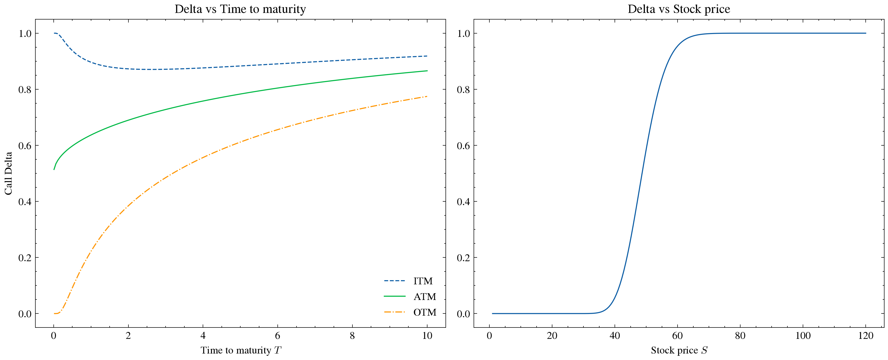
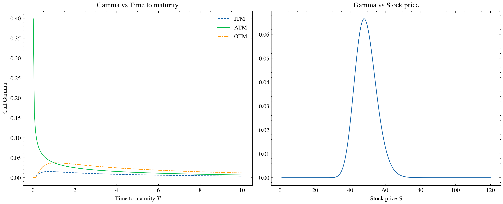
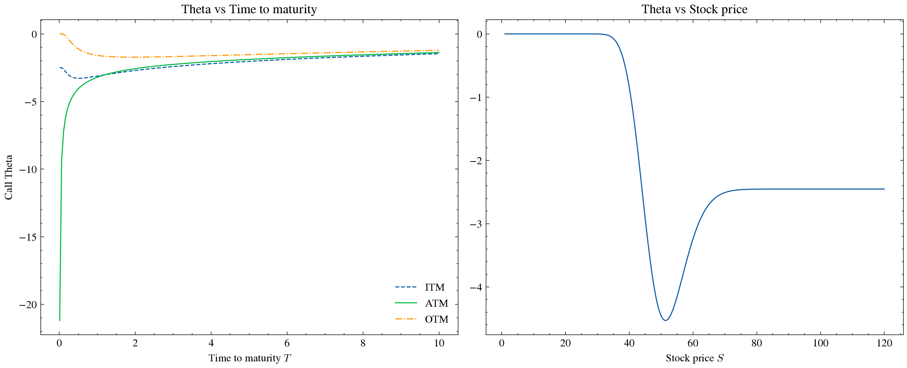

## Overview
19장 Greeks를 읽고 델타, 감마, 세타, 베가, 로의 계산 프로그램을 구현했다.

델타, 세타, 감마의 기초자산 가격과 만기에 따른 움직임을 그래프로 확인했다.

## Greeks

- Delta : $\Delta = \dfrac{\partial f}{\partial S}$ , 기초자산 가격에 대한 옵션 가격의 변화율
- Gamma : $\Gamma = \dfrac{\partial^2 f}{\partial S^2}$ , 기초자산 가격에 대한 델타의 변화율
- Theta : $\Theta = \dfrac{\partial f}{\partial t}$ , 시간에 대한 옵션 가격의 변화율
- Vega : $\nu = \dfrac{\partial f}{\partial \sigma}$ , 변동성에 대한 옵션 가격의 변화율
- Rho : $\rho = \dfrac{\partial f}{\partial r}$ , 무위험 이자율에 대한 옵션 가격의 변화율

$$
d_1 = \frac{\ln(S/K) + \left(r - q + \frac{\sigma^2}{2}\right)T}{\sigma\sqrt{T}},
\qquad
d_2 = d_1 - \sigma\sqrt{T}
$$

### Delta

$$
\Delta_{call} = e^{-qT} N(d_1), \qquad
\Delta_{put} = e^{-qT}\left[N(d_1) - 1\right]
$$

- 주가 그래프 : S자 모양으로 0에서 1로 올라가고, K 근처에서 0.5쯤이다. 주가가 $0 \to \infty$ 로 갈때, $d_1$ 도 $-\infty \to \infty$ 로 간다. $N(d_1)$ 은 누적분포함수이므로, Delta도 S자 모양으로 증가함을 알 수 있다. 외가격이랑 내가격부분의 Delta의 기울기가 0처럼 보이지만 아주 작은 양수이고 0은 아니다.

- 만기 그래프 : 내가격이면, $T \to 0$ 으로 갈때, $d_1 \to +\infty$ 으로 가고, 따라서 1로 수렴한다. 외가격이면, $T \to 0$ 으로 갈때, $d_1 \to -\infty$ 으로 가고, 따라서 0으로 수렴한다. 등가격이면, $d_1$ 의 $\ln K - \ln S$ 가 0이 되므로 $d_1 \to 0$ 으로 가고 0.5로 수렴한다. 

### Gamma

$$
\Gamma = \frac{N'(d_1)\, e^{-qT}}{S \sigma \sqrt{T}}
$$

- 주가 그래프 : Gamma는 Delta를 한번 더 기초자산(주가)가격으로 미분한 값이다. 따라서 Delta가 급격히 상승하는 등가격 주위에서, Gamma의 값도 급격히 증가했다가 등가격일때를 기준으로 다시 내려온다. 

- 만기 그래프 : Delta와 마찬가지로 외가격,내가격은 각각 $T \to 0$ 일때 $d_1 \to -\infty$ 으로 가고, $d_1 \to +\infty$ 로 간다. 다만 $N'(d_1)$ 은 확률밀도함수이므로, $N'(d_1) \to 0$ 으로 간다. 분모의 $\sqrt{T} \to 0$ 이지만 분자의 $N'(d_1)$ 이 더 빠르게 0으로 수렴하므로 전체는 0으로 수렴한다. 등가격일땐 $d_1 \to 0$ 이고, $N'(0) \approx 0.4$ 로 유한한데 분모 $\sqrt{T} \to 0$ 이라 $+\infty$ 로 발산한다.

### Theta

$$
\Theta_{call} = -\frac{S N'(d_1) \sigma e^{-qT}}{2\sqrt{T}} + qS N(d_1) e^{-qT} - rK e^{-rT} N(d_2)
$$

$$
\Theta_{put} = -\frac{S N'(d_1) \sigma e^{-qT}}{2\sqrt{T}} - qS N(-d_1) e^{-qT} + rK e^{-rT} N(-d_2)
$$

- 주가 그래프 : $S \to 0$ 일때, 깊은 외가격이 되고 $N'(d_1) \to 0$ 이다. $N(d_1) \to 0$ , $N(d_2) \to 0$ 이므로 전체는 0으로 수렴한다. 등가격 주위에서, $N'(d_1)$ 은 가장 커지므로 첫항은 비교적 큰 음수가 되고 둘째 항과 셋째 항은 중간정도의 값을 갖게된다. 그리고 $S \to \infty$ 일때 $N'(d_1) \to 0$ , $N(d_1), N(d_2) \to 1$ 이므로, $qSe^{-qT} - rKe^{-rT}$ 에 가까워진다.

- 만기 그래프 : 첫 항이 Gamma와 같이 분자에 $N'(d_1)$ 이 있고, 분모에 $\sqrt{T}$ 가 있다. 따라서 $T \to 0$ 의 경우에서 외가격, 내가격 일때 Gamma와 같은 이유로 첫 항이 0으로 수렴한다. 내가격일 경우 $N(d_1), N(d_2) \to 1$ , 그러므로 전체는 $qS - rK$ 로 수렴한다. 외가격일경우 $N(d_1), N(d_2) \to 0$ , 그러므로 전체가 0으로 수렴한다. 등가격일 경우 $d_1 \to 0$ 이므로 $N'(d_1)$ 이 0이 아니고, 분모의 $\sqrt{T} \to 0$ 이라 첫 항 $\to -\infty$ 이다. $T \to \infty$ 의 경우, 서로 가까워지고, $-rKe^{-rT}N(d_2)$ 항 때문에 천천히 0 방향으로 간다.