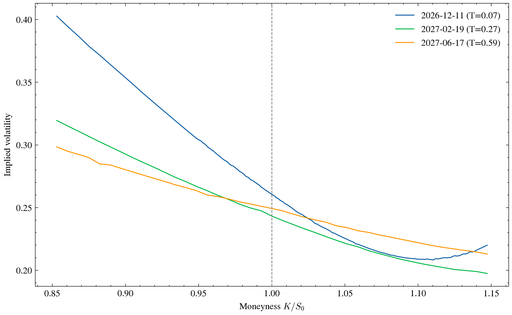
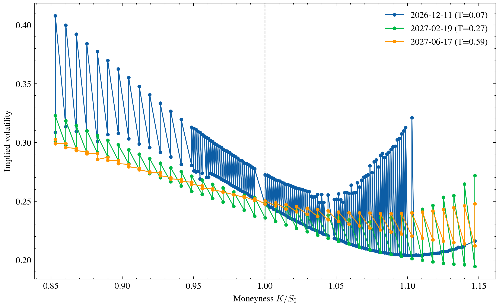

## Overview
20장을 읽고 Volatility smiles를 실제 시장 데이터로 구현해봤다.

## Implied Volatility

$$
c_{mkt} = c_{BS}(S_0, K, r, q, T, \sigma_{imp})
$$

- 옵션의 Implied Volatility는 Black Scholes로 도출한 옵션가격이 시장 가격과 같아지게 만드는 변동성이다. $S_0, K, r, q, T$ 는 이미 알고 있거나 알 수 있고, $\sigma_{imp}$ 만 모르기 때문에 역산이 가능하다.

### Newton-Raphson

$$
\sigma_{n+1} = \sigma_n - \frac{c_{BS}(\sigma_n) - c_{mkt}}{\nu(\sigma_n)}
$$

- Implied Volatility를 계산하는 식에서 $\sigma$ 에 대해 식을 풀어보면 결국 풀 수 없다. 따라서 이분법을 사용하거나, 뉴턴-랩슨 갱신식을 사용해야 한다. 구현에서는 뉴턴-랩슨 갱신식을 사용했다. 접선의 방정식을 이용해 식을 0으로 만드는 $\sigma_{n+1}$ 를 찾고, 이 값의 위치에서 식을 다시 0으로 만드는 $\sigma_{n+2}$ 를 찾는 방식으로 식을 0으로 수렴시키는 $\sigma$ 를 찾았다.

### Put-Call Parity

$$
c + Ke^{-rT} = p + S_0e^{-qT}
\qquad \Rightarrow \qquad
q = -\frac{1}{T}\ln\frac{c - p + Ke^{-rT}}{S_0}
$$

- q를 시장가격과 Put-Call Parity를 통해 역산하여 구했다. 콜과 풋의 내재변동성이 같아지도록 하려면 Black Scholes의 $c - p$ 가 시장의 $c - p$ 와 같아야 하는데, 임의로 정한 q로는 둘이 어긋나기 때문이다.

## Volatility Smile

yfinance로 받은 QQQ 옵션 체인(2026-11-14 기준)에서 만기 3개(약 1, 3, 6개월)를 골라, 외가격 옵션의 매수, 매도 호가 중간값으로 역산한 내재변동성을 $K/S_0$ ( $0.85 \sim 1.15$ )에 대해 그렸다.

- 행사가격 그래프 : 책의 주식옵션 그래프처럼 행사가격이 높을수록 변동성이 낮고, 행사가격이 낮을수록 변동성이 높은 모습을 확인할 수 있다. Black Scholes에 따르면, 특정 기초자산의 $\sigma$ 를 공통으로 적용하므로 수평선으로 나타나야 하는데, 사실은 행사가격에 따라 $\sigma$ 가 달랐다.

- 만기 비교 : 만기가 길어질수록, 만기 주가 $\ln S_T$ 가 따르는 정규분포의 $\sigma\sqrt{T}$ 가 커진다. 따라서 같은 행사가격이라도, 만기가 길어질수록 평균에서 더 조금 떨어진 지점이 되고, 내재분포와 비교했을 때 꼬리 두께의 차이가 만기가 짧을 때보다 덜 나게 된다. 따라서 같은 범위의 행사가격에 따른 volatility smile이 만기가 길어질수록 완만해진다.

## Difficulties

### Sawtooth

- 현상 : 처음에 그린 volatility smile이다. 각 행사가격에서 위아래로 지그재그로 진동하고 있다.

- 원인 : 처음에는 q를 시장가격으로 역산하지 않고 고정된, 가정된 값을 사용했다. 다만 이렇게 하면 아래 식처럼, 콜과 풋의 가격 오차의 차이가 0이 아니라 $S_0\left(e^{-q_{mkt}T} - e^{-qT}\right)$ 만큼 나고 따라서 IV도 달라짐을 깨달았고, 또 한 행사가격에 풋과 콜을 둘 다 표시함으로써 발생한 문제였다.

$$
c_{mkt} + Ke^{-rT} = p_{mkt} + S_0e^{-q_{mkt}T}
$$

$$
c_{BS} + Ke^{-rT} = p_{BS} + S_0e^{-qT}
$$

$$
\left(c_{mkt} - c_{BS}\right) - \left(p_{mkt} - p_{BS}\right) = S_0\left(e^{-q_{mkt}T} - e^{-qT}\right)
$$

- 해결 : q를 시장가격을 통해 역산하고 그 q를 사용했다. 이렇게 하면 완전히 0은 아니어도, $S_0\left(e^{-q_{mkt}T} - e^{-qT}\right)$ 이 매우 작아지기 때문에 풋, 콜의 IV 차이가 거의 줄어들게 된다. 이렇게 IV를 일치시키고 둘 중 외가격인 옵션을 사용했다. 외가격을 사용한 이유는 외가격이 내가격보다 호가차이가 좁아서 정확성이 높다는 사실과, 내가격 풋은 ch13_15 README에서 볼 수 있듯이 조기행사가치가 있으므로 조기행사를 고려하지 않는 Black Scholes로 계산하면 IV에 오차가 생긴다는 사실을 근거로 했다.
