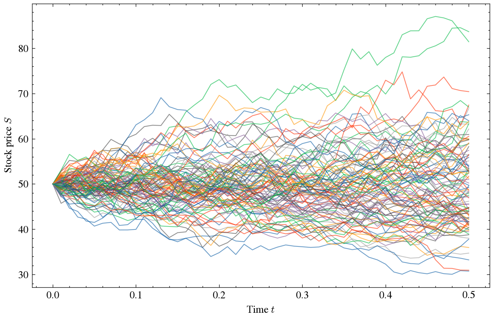

## Overview
21장 이항과정, 몬테카를로 시뮬레이션, 유한차분법 중 몬테카를로 방식으로 유러피안 콜옵션 가치평가를 구현.

## Monte Carlo Simulation

$S = 50$ , $r = 0.05$ , $q = 0.01$ , $\sigma = 0.3$ , $K = 50$ , $\Delta t = 0.01$ , $N = 50$ , $T = 0.5$ 인 기초변수의 다양한 경로

### Stock Price Path

위험중립 가정하에 기초변수 S가 기하 브라운 운동을 따른다고 가정하였다. 옵션 가격은 기초변수의 실제 기대수익률과 무관하므로, 기대수익률 자리에 무위험이자율 r(배당수익률이 있으면 $r - q$ )을 넣어 계산한다.

$$
dS = (r - q)S\,dt + \sigma S\,dz
$$

이 식에 이토 정리를 적용하면 $\ln S$ 의 과정이 나온다.

$$
d\ln S = \left(r - q - \frac{\sigma^2}{2}\right)dt + \sigma\,dz
$$

이 식을 이산화하여 이전 단계의 가격으로 다음 단계의 가격을 구하였다. 매 $\Delta t$ 마다 표준편차 1, 평균 0인 표준정규분포를 따르는 난수를 추출하여 변동시켰다.

$$
S(t + \Delta t) = S(t)\exp\left[\left(r - q - \frac{\sigma^2}{2}\right)\Delta t + \sigma\varepsilon\sqrt{\Delta t}\right]
$$

계수가 상수이므로 이 식은 기간의 크기와 관계없이 이산화해도 근사가 아니라 정확한 값을 준다. 초기 기초변수로 만기값을 한 번에 구할 수도 있지만, 기초변수의 여러 변화과정을 관찰해보기 위해 $\Delta t$ 를 0.01로 뒀다.

### Results

| M | Call price | Std error |
|---:|---:|---:|
| 100 | 3.5526 | 0.6015 |
| 1,000 | 4.9043 | 0.2378 |
| 10,000 | 4.6839 | 0.0738 |
| 100,000 | 4.6405 | 0.0231 |
| Black-Scholes | 4.6718 | |

- 각 시뮬레이션의 만기 S 마다의 call의 가치를 계산하고, 이 가치들의 기댓값을 추정하여 무위험 이자율로 할인해 현재 call의 가치를 구했다.

- 시뮬레이션 횟수를 점점 늘리며 진행한 결과이다. 시행횟수를 늘림에 따라 표준오차가 줄어든다. 즉, 실제 모수를 더 정확하게 추정할 수 있다.

- 블랙-숄즈 값 4.6718은 모든 M에서 추정치 ± 1.96 × 표준오차 범위 안에 들어온다.